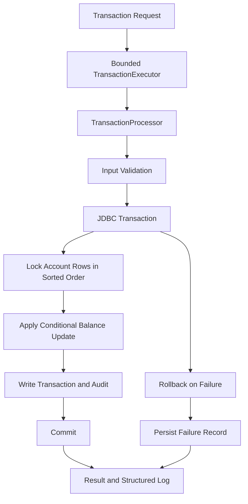

# Architecture

The application is separated into request/result models, a transaction processor, a bounded executor, database configuration, and benchmark tooling. The database owns durable balances, uniqueness, foreign keys, checks, and audit records.
