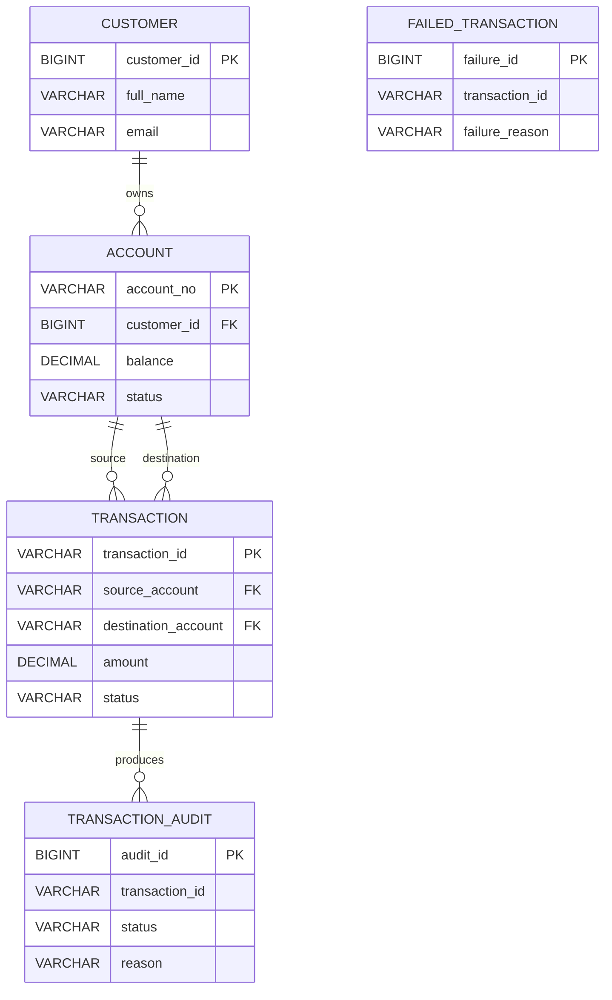

# Entity Relationship Diagram

`FAILED_TRANSACTION` intentionally retains failure details independently of the rolled-back monetary transaction. It is linked by the submitted transaction identifier rather than a foreign key so failures can also be recorded when an account identifier is invalid.
